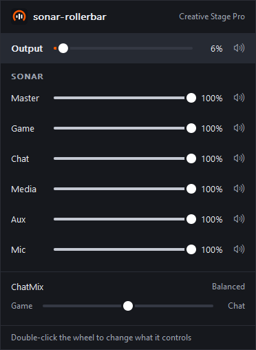
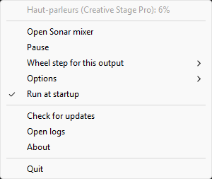

<div align="center">


# sonar-rollerbar

**Your keyboard's volume wheel, on your real speakers or headset.**

A small Windows utility for setups where the default output is a virtual device, such as a
SteelSeries Sonar channel.

[](https://github.com/BastienPoP/sonar-rollerbar/actions/workflows/ci.yml)
[](https://github.com/BastienPoP/sonar-rollerbar/releases/latest)
[](LICENSE)

**[Download](https://github.com/BastienPoP/sonar-rollerbar/releases/latest)** ·
[What it does](#what-this-program-does) ·
[Install](#install) ·
[SteelSeries options](#steelseries-options) ·
[Troubleshooting](#troubleshooting)

Not affiliated with SteelSeries.

</div>

## Why

When a virtual device is the Windows default output, the volume wheel changes that device rather
than the output you listen on. With Sonar, the wheel moves a single channel and upsets your mix.
This program sends the wheel to the output you chose:

| | Windows alone | With sonar-rollerbar |
| --- | --- | --- |
| Turning the wheel changes | the default output, such as a Sonar channel | your speakers or headset |
| Clicking the wheel mutes | the default output | your speakers or headset |
| Play/Pause, Next, Previous | work as usual | work as usual |

## Features

**The program's main job is simple: your volume wheel controls the output you chose.** That works
as soon as it's installed, with no option to tick, and it opens no connection.

- **Any wheel keyboard.** It works with any keyboard whose wheel sends the standard Volume Up,
  Volume Down and Mute keys. It was developed on a SteelSeries Apex Pro.
- **Your outputs, in your order.** If the first one disconnects, the wheel moves to the next, and
  it comes back when the first one returns.
- **A wheel step for each output**, set from the tray menu.
- **Light and easy to audit.** One executable under 1 MB and one direct dependency, with no
  administrator rights, service or driver.

**Everything else is optional.** With SteelSeries GG, [five options](#steelseries-options) add
features on top. All of them are off until you tick them:

- **OLED:** the keyboard's screen shows what changed and its level.
- **Sonar mixer:** a window with sliders and mute buttons for your output, Master, Game, Chat, Media,
  Aux and Mic, plus ChatMix.
- **Follow Sonar's output:** change the output in GG and the wheel moves with it.
- **Double-click the wheel:** point it at ChatMix or a Sonar channel, including the Mic, instead of
  your output. After 10 seconds, it returns to your output.
- **Include Master:** add Master to what the double click can reach.

## Screenshots

<table>
  <tr>
    <th>Sonar mixer</th>
    <th>Tray menu</th>
  </tr>
  <tr>
    <td valign="top"></td>
    <td valign="top"></td>
  </tr>
</table>

## What this program does

A global keyboard hook runs in the path of every keystroke on the system, passwords included. This
one:

- intercepts only Volume Up, Volume Down and Mute, and passes every other key straight to Windows,
  including Play/Pause;
- doesn't read or store any other key, even in debug builds;
- never connects to anything outside your computer, and only talks to SteelSeries software on
  `127.0.0.1` for the options you turn on, which are all off by default;
- doesn't read the clipboard, and only writes its own settings and a small log with no keys in it;
- doesn't ask for administrator rights and installs no service or driver;
- lets the key through if anything goes wrong or if no selected output is available.

You can check this yourself: the hook is a single function,
[`keyboard_proc`](src/win.rs#L91), and all `unsafe` code lives in [src/win.rs](src/win.rs) and
[src/win/](src/win). [SECURITY.md](SECURITY.md) has the details, including the threat model and how
to audit a release.

## Install

1. Download `sonar-rollerbar-setup-vX.Y.Z.exe` from the
   [releases page](https://github.com/BastienPoP/sonar-rollerbar/releases).
2. [Verify the download](SECURITY.md#verifying-a-download).
3. Run the installer. It doesn't need administrator rights and lets you choose:
   - the main output and an optional fallback, which is all the program needs;
   - any of the [SteelSeries options](#steelseries-options), which add features and are all off by
     default;
   - whether to start automatically when you sign in.

To uninstall, use **Settings > Apps > Installed apps**. This stops the program and removes its
shortcuts, settings and logs. To change your output choices, run the installer again.

### Windows warnings

The installer and the executable aren't signed.

- **SmartScreen** may show "Windows protected your PC" for a downloaded file. After verifying the
  file, select **More info**, then **Run anyway**.
- **Smart App Control**, if enabled, may block the file based on its reputation and offers no way
  to bypass it. You would need a signed build, or to turn this protection off in Windows Security.

## Keys

| Key | Effect |
| --- | --- |
| Turn the wheel | Changes the chosen output's volume. Turning up also unmutes it. |
| Click the wheel (Mute) | Mutes or unmutes the chosen output. |
| Double-click the wheel | With [its option](#choosing-what-the-wheel-controls) on, changes what the wheel controls. |
| Play/Pause, Next, Previous and every other key | Unchanged. |

## Choosing the output

There is no default output: you must pass `--device`, `--auto` or both. To see what's available:

```powershell
sonar-rollerbar --list-devices
```

```text
  [physical] Speakers (Example Soundbar)
  [physical] Headphones (Example Headset)
  [virtual]  SteelSeries Sonar - Gaming (SteelSeries Sonar Virtual Audio Device)
```

### By name, in order of preference

`--device` takes part of a name, ignoring case, and can be repeated. Earlier entries have priority:

```powershell
sonar-rollerbar --device "Soundbar" --device "Headset"
```

If the soundbar disconnects, the wheel moves to the headset. When the soundbar comes back, the
wheel returns to it. Outputs are rechecked every 2 seconds and on every key.

### Automatically

`--auto` selects the first physical output, based on the bus Windows reports: USB, HDMI or built-in
audio count as physical, and software devices don't. Outputs with "Sonar" in their name are always
ignored, in every mode.

If you have several physical outputs, Windows decides which comes first, and a headset's wireless
dongle can count as connected even when the headset is off. Use `--device` to set the order
yourself, or the [option to follow Sonar's output](#following-sonars-output). `--auto` can also
follow named outputs as a last resort:

```powershell
sonar-rollerbar --device "Soundbar" --auto
```

Add `--list-devices` to any of these commands to see which output would be selected, marked `*`.

If no selected output is available, volume keys continue to Windows as usual.

## Keyboards

Volume keys are handled whichever keyboard sends them. That covers keyboards with a hardware wheel
and the Apex Pro wheel through SteelSeries GG, so most setups need nothing more.

<details>
<summary>Keeping another keyboard's volume keys with <code>--injected-only</code></summary>

`--injected-only` is for the rare case where another keyboard's volume keys should keep their normal
behaviour. Some vendor software creates these keys itself instead of the keyboard sending them
directly, as SteelSeries GG does for the Apex Pro wheel. Windows marks such keys as *injected*, and
this option handles only those. The installer doesn't offer it: add it to your shortcut's target.

| Volume key comes from | With `--injected-only` | Without it |
| --- | --- | --- |
| SteelSeries GG (Apex Pro wheel) | changes your chosen output | changes your chosen output |
| Keyboard with a hardware wheel | normal Windows behaviour | changes your chosen output |
| Another keyboard's volume keys | normal Windows behaviour | changes your chosen output |
| A macro tool that injects keys | changes your chosen output | changes your chosen output |

Leave it out for a keyboard with a hardware wheel, or the wheel will be ignored.

The filter looks at how a key was produced, not at which keyboard sent it. Windows doesn't tell a
hook which device a key came from.

</details>

## Tray icon

While it runs, the program shows an icon in the notification area. Windows 11 may place it in the
hidden icons menu: drag it onto the taskbar to keep it visible.

Hovering over it shows the current output and volume. Right-clicking opens the menu. Left-clicking
opens the Sonar mixer if that option is on, and the menu otherwise.

| Item | Effect |
| --- | --- |
| Current output and volume | Status only: this line can't be clicked. |
| **Open Sonar mixer** | Shown if the option is on. |
| **Pause** | Lets volume keys through to Windows until you select it again. |
| **Wheel step for this output** | Sets the volume change per notch. Each output keeps its own. |
| **Options** | Turns the [SteelSeries options](#steelseries-options) on or off. |
| **Run at startup** | Adds or removes the sign-in shortcut, with your current options. |
| **Check for updates** | Opens the releases page in your browser. |
| **Open logs** | Opens the logs folder. |
| **About** | Shows the version, license, project address and notices. |
| **Quit** | Stops the program. |

The program never contacts anything to look for updates: that item only opens the page.

If the icon can't be shown, the volume wheel keeps working, and you can stop the program with:

```powershell
taskkill /IM sonar-rollerbar.exe /F
```

## SteelSeries options

You don't need any of these for the wheel to control your output. Each one adds a feature on top.

All of them are off by default. You can tick them in the installer and change them at any time from
**Options** in the tray menu. With all of them off, the program opens no connection at all.

| Option | What it adds | What it needs |
| --- | --- | --- |
| **Show volume on keyboard OLED** | For 3 seconds after each change, the keyboard's screen shows what changed and its level. | GG and a keyboard with a screen |
| **Sonar mixer** | A window, opened by clicking the tray icon, with sliders and mute buttons for your output, Master, Game, Chat, Media, Aux and Mic, plus ChatMix. | GG with Sonar |
| **Follow Sonar's output** | When you change Sonar's output in GG, the wheel moves to it. Without this option, the wheel stays on the output you chose. | GG with Sonar |
| **Double-click the wheel to choose what it controls** | A double click points the wheel at ChatMix, Game, Chat, Media, Aux or Mic instead of your output. | GG with Sonar |
| **Include Master in the double click** | Adds Master to those choices. It only applies with the option above. | GG with Sonar |

They use SteelSeries GG's local services. Sonar's API is unofficial and could change with any GG
update: if it does, these options stop and the volume wheel keeps working.

Only the Monitoring sliders are used in Streamer mode. There, the GG window redraws as you change a
value. Sonar offers no way to do this in Classic mode, so the GG window may only update once you
reopen it.

### Choosing what the wheel controls

A double click moves the wheel to the next of Output, ChatMix, Game, Chat, Media, Aux and Mic. With
**Include Master in the double click**, Master comes right after ChatMix. The OLED, the mixer window
and the tray icon's tooltip show where the wheel is. After 10 seconds without touching the wheel, it
returns to Output by itself.

- Turning changes the target by your wheel step, or by 5% for ChatMix.
- Clicking mutes or unmutes the target, and recentres ChatMix. On Mic, this mutes your microphone.
- Master rescales Game, Chat, Media and Aux together: see
  [How Sonar's volumes work](#how-sonars-volumes-work).
- While this option is on, a single click takes about a third of a second to act, because the
  program has to wait for a possible second click.
- ChatMix is skipped when Sonar can't set it, for example with a headset that has its own ChatMix
  dial, or when Game and Chat use different outputs. The GG window has the same limits.

### How Sonar's volumes work

Sonar treats Master as a ceiling, as the Windows volume mixer does:

- moving Master scales Game, Chat, Media and Aux by the same ratio, and they return exactly when
  you move it back;
- raising one channel above Master pushes Master up to it and leaves the others where they are;
- lowering that channel again doesn't bring Master back down.

The level shown on a channel is its real level: Master is already included in it.

The simplest setup is to leave Master at 100% and use the wheel for the overall volume, so that the
channels only set the balance between them. This program never changes Master by itself: only the
mixer, or the wheel while you point it at Master, can move it.

### Following Sonar's output

With this option on, the wheel controls the output Sonar plays to, so changing it in GG moves the
wheel there within a second. This is the output of the Game channel, or of the Monitoring mix in
Streamer mode. Your `--device` and `--auto` choices only apply when that output isn't available, or
when GG has never answered. Each output keeps its own volume.

## Command line

```text
sonar-rollerbar (--device <partial name>)... [--auto] [--step <percent>] [--injected-only]
sonar-rollerbar --list-devices [--device <partial name>]... [--auto]
```

| Option | Effect | Default |
| --- | --- | --- |
| `--device` | Part of an output name. Repeat it to set an order of preference. | none |
| `--auto` | Use the first physical output, after any named ones. | off |
| `--step` | Volume change per notch for outputs without their own, from 1 to 100. | `2` |
| `--injected-only` | Handle only keys created by software. | off |
| `--list-devices` | Show active outputs and exit. | |

At least one of `--device` and `--auto` is required, except with `--list-devices`.

## Files

Everything is in `%LOCALAPPDATA%\sonar-rollerbar`.

- `config.ini` holds the SteelSeries options and the wheel step of each output.
- `logs` holds program events such as starting, changing output, pausing and errors. It never
  contains keys, not even volume keys. At 512 KB the file is rotated and only one previous file is
  kept, so logs never take more than about 1 MB.

## Start at sign-in

The installer and the tray menu both offer this, and they use the same shortcut. To set it up by
hand, press `Win+R`, enter `shell:startup` and create a shortcut to the executable there, with your
options in its target:

```text
"C:\path\to\sonar-rollerbar.exe" --device "Soundbar"
```

Keep the executable on the Windows side rather than in WSL, which isn't running at sign-in. Without
`--device` or `--auto`, the program exits at once with no visible message.

## Troubleshooting

| Symptom | Likely cause |
| --- | --- |
| The wheel sometimes changes the default output | A window running as administrator has focus: see [below](#games-running-as-administrator). |
| The wheel changes a Sonar channel instead of your output | A double click moved it: wait 10 seconds. |
| The OLED or Sonar options do nothing | GG isn't running: see the logs for the reason. |
| Nothing appears when you turn the wheel | The wheel doesn't send these keys, so this program can't use it. |
| Nothing happens with `--injected-only` | The keys are `injected=no`: remove the option. |
| `swallowed=no` | Paused, or no selected output is available: check `--list-devices`. |

<details>
<summary>What a debug build prints</summary>

Debug builds keep a console and print the selected output, the resulting volume and, for keys 0xAD,
0xAE and 0xAF only, whether they were injected and swallowed.

```text
target output: Speakers (Example Soundbar)
volume: 48%
key 0xAF press injected=yes swallowed=yes
key 0xAF release injected=yes swallowed=yes
```

</details>

### Games running as administrator

Windows doesn't pass keys meant for a window running as administrator to this hook. While such a
window has focus, volume keys keep their normal Windows behaviour: the wheel changes the Windows
default output, which can be a Sonar channel, and a double click has no effect. Clicking another
window or screen brings the program back at once.

This often happens with games. Start the game without administrator rights if it doesn't need them.
Some games, such as Aion 2, start themselves with these rights, so there is nothing to change: the
wheel can't control your chosen output while they have focus.

Running this program as administrator isn't supported, because it would give a global keyboard hook
full control of your computer.

## Building from source

<details>
<summary>Build instructions</summary>

In WSL, or any Linux with Rust installed:

```sh
sudo apt install gcc gcc-mingw-w64-x86-64
cargo build --release --locked --target x86_64-pc-windows-gnu
```

The result is `target/x86_64-pc-windows-gnu/release/sonar-rollerbar.exe`. `rust-toolchain.toml`
sets the Rust version and target. Leave out `--release` for a debug build.

To build the installer on Windows, install [Inno Setup](https://jrsoftware.org/isinfo.php) 6.7, then
run this from the repository root:

```powershell
iscc /DAppVersion=0.1.1 installer\sonar-rollerbar.iss
```

</details>

## Releases

Pushing a `v*` tag that matches the version in `Cargo.toml` runs the checks, builds the executable
and installer, attests their provenance and publishes them with their SHA256 checksums.

## Credits

This project was inspired by
[steelseries-apex-roller](https://github.com/StableFlux/steelseries-apex-roller) by StableFlux, a
tray app that maps the Apex Pro Gen 3's wheel and media button to Sonar's channels.

## License

[MIT](LICENSE)
